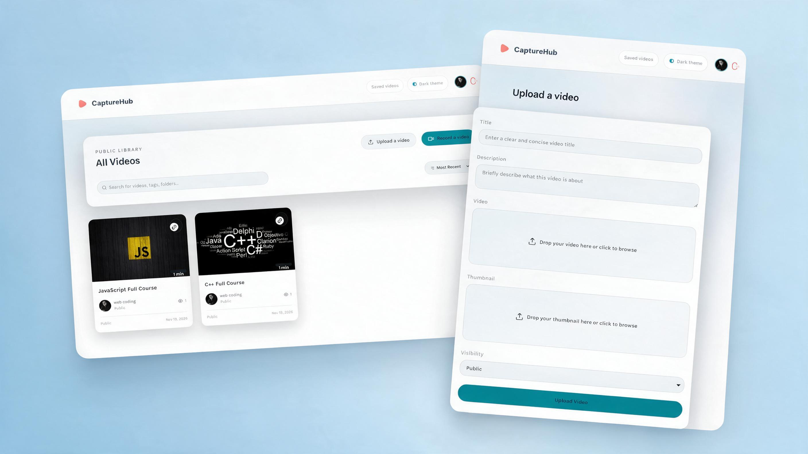

# 🎥 ScreenFlow

<div align="center">




### 🚀 Screen Recording & Video Sharing Platform

Record your screen, upload videos, and securely share content through a modern full-stack application.

</div>

---

# 📖 Overview

**ScreenFlow** is a modern full-stack screen recording and video sharing platform that enables users to record their screens, upload videos, and share content securely.

Built with **Next.js**, **Object-storage Neon**, **Better Auth**, **Arcjet**, **Neon**, and **Drizzle ORM**, the platform combines high-performance video hosting, secure authentication, intelligent search, and scalable infrastructure into a production-ready application.

---

# ✨ Core Features

## 🎥 Screen Recording

Record your screen directly inside the application.

### Features

- Browser-based screen recording
- High-quality video capture
- Instant recording sessions
- Seamless recording workflow

---

## ☁️ Video Upload & Storage

Upload and manage videos with ease.

### Features

- Fast video uploads
- Bunny.net video storage
- Optimized video delivery
- Secure cloud storage

---

## 🔗 Video Sharing

Share videos effortlessly.

### Features

- Unique shareable links
- Public & private videos
- Quick access via URL
- Easy content distribution

---

## 🔐 Authentication & Security

Secure user accounts and application infrastructure.

### Features

- Better Auth authentication
- Google Sign-In
- Protected user sessions
- Secure authorization

---

## 📊 Video Metadata

Access detailed information about every video.

### Features

- Video ID
- Shareable URL
- Upload details
- Video information management

---

# 🚀 Getting Started

## 1️⃣ Clone the Repository

```bash
git clone https://github.com/yourusername/screenflow.git

cd screenflow
```

---

## 2️⃣ Install Dependencies

```bash
npm install
```

---

## 3️⃣ Configure Environment Variables

Create a `.env.local` file:

```env
DATABASE_URL=

BETTER_AUTH_SECRET=
BETTER_AUTH_URL=

GOOGLE_CLIENT_ID=
GOOGLE_CLIENT_SECRET=


# S3-compatible storage. Generate a credential to fill in the key ID + secret.
AWS_ENDPOINT_URL_S3=
AWS_ACCESS_KEY_ID=
AWS_SECRET_ACCESS_KEY=
```

---

## 4️⃣ Run Development Server

```bash
npm run dev
```

Open:

```
http://localhost:3000
```


---

# 🌟 Key Highlights

- 🎥 Browser-based screen recording
- ☁️ High-performance video hosting
- 🔗 Shareable video links
- 🔒 Public & private privacy controls
- 🛡️ Advanced security with Arcjet
- 🔍 Intelligent video search
- 📊 Rich video metadata
- ⚡ Fast and scalable architecture
- 📱 Fully responsive UI

---

# ❤️ Final Note

ScreenFlow is a production-ready screen recording and video sharing platform that combines modern web technologies, cloud video infrastructure, AI-powered transcripts, and enterprise-grade security into a seamless user experience.

---

<div align="center">

## 🎥 Record • Share • Collaborate

</div>